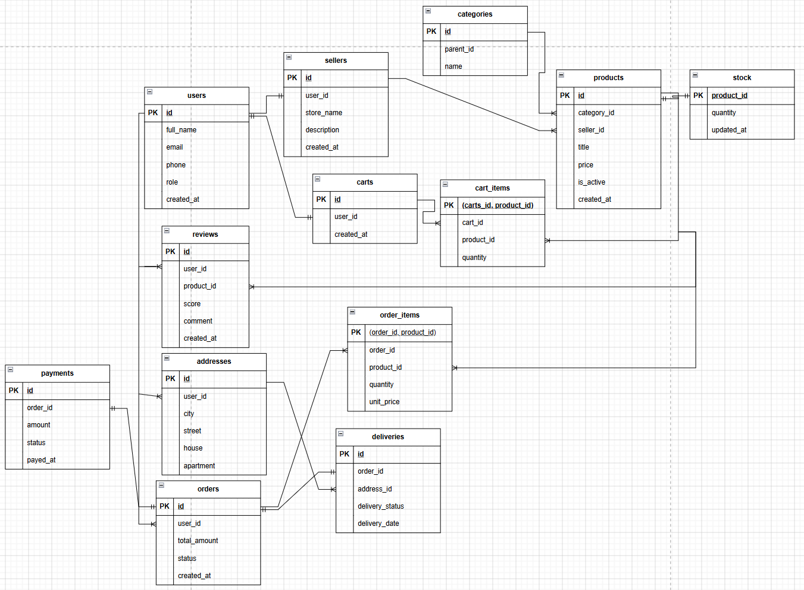

# Отчет по лабораторной работе № 1 по дисциплине "Математические основы баз данных"
## Тема: Проектирование и создание структуры базы данных маркетплейса
### Техническое задание 
Спроектируйте и реализуйте структуру базы данных маркетплейса 
согласно описанию предметной области. 
1. Проведите анализ предметной области и сформулируйте перечень 
бизнес-правил (например: у товара ровно один продавец; заказ 
принадлежит одному покупателю и содержит хотя бы одну позицию; 
отзыв оставляется к конкретному товару конкретным пользователем). 
2. Постройте ER-диаграмму, включающую не менее десяти сущностей. 
Схема должна содержать хотя бы одну связь «многие-ко-многим» 
17 
через ассоциативную таблицу и хотя бы одну иерархическую связь 
(самоссылку). 
3. Приведите схему к третьей нормальной форме. На примере одной 
таблицы покажите аномалию до нормализации и поясните, как она 
устранена. 
4. Определите для каждой таблицы первичный ключ; обоснуйте выбор 
суррогатных или естественных ключей. 
5. Реализуйте схему в PostgreSQL средствами DDL: создайте таблицы с 
корректными типами, первичными и внешними ключами, 
ограничениями NOT NULL, UNIQUE, CHECK, DEFAULT и правилами 
ON DELETE / ON UPDATE. 
6. Составьте словарь данных: для каждой таблицы перечислите столбцы, 
их типы, ограничения и назначение. 
7. Оформите все команды единым SQL-скриптом, повторное выполнение 
которого воссоздаёт схему с нуля. 
## Выполнение
**Задание 1: Анализ предметной области**

1. **Пользователи и продавцы:**
   - Один пользователь может быть как покупателем, так и владельцем магазина-продавца.
   - У каждого продавца есть ровно один пользователь-владелец.
   - Пользователь должен иметь уникальный email.

2. **Категории товаров:**
   - Категории образуют иерархическое дерево: у категории может быть одна родительская категория или не быть её вовсе (корневая категория).
   - Название категории уникально.

3. **Товары:**
   - Каждый товар принадлежит ровно одному продавцу.
   - Каждый товар относится ровно к одной категории.
   - Цена товара должна быть строго больше нуля.
   - Товар имеет статус активности (`is_active`).

4. **Складские остатки:**
   - Для каждого товара хранится количество доступных единиц.
   - Количество не может быть отрицательным.

5. **Корзина:**
   - У каждого пользователя может быть только одна активная корзина.
   - В корзине могут быть товары от разных продавцов.
   - Одна и та же позиция товара не может дублироваться в корзине (если добавляешь тот же товар — увеличивается количество).

6. **Заказы:**
   - Заказ создаётся на основе корзины пользователя.
   - Заказ принадлежит ровно одному пользователю-покупателю.
   - Заказ содержит хотя бы одну позицию.
   - Позиция заказа фиксирует цену товара на момент покупки (`unit_price`), которая может отличаться от текущей цены товара.
   - Количество в позиции заказа должно быть больше нуля.

7. **Платежи:**
   - Каждый заказ оплачивается одним платежом.
   - Платёж привязан ровно к одному заказу.

8. **Отзывы:**
   - Отзыв оставляется конкретным пользователем к конкретному товару.
   - Один пользователь может оставить только один отзыв на один товар.
   - Оценка находится в диапазоне от 1 до 5.

9. **Адреса и доставки:**
   - У пользователя может быть несколько адресов доставки.
   - Каждый заказ доставляется по одному адресу.
   - Доставка привязана ровно к одному заказу.

**Задание 2: Построение ER-диаграммы**

**Задание 3: Нормализация**
Схема базы данных приведена к третьей нормальной форме (3НФ). Для демонстрации необходимости нормализации рассмотрим пример денормализованной таблицы заказов, которая могла бы возникнуть при проектировании.

### Денормализованная таблица `orders`

Предположим, мы храним всю информацию о заказе, пользователе и товаре в одной таблице:

| order_id | order_date | user_name | user_email | product_title | product_price | seller_name | quantity |
|----------|------------|-----------|------------|---------------|---------------|-------------|----------|
| 1 | 2026-10-01 | Иванов | ivan@mail.ru | iPhone 15 | 99990 | ТехноМир | 1 |
| 1 | 2026-10-01 | Иванов | ivan@mail.ru | Чехол | 990 | АксПром | 2 |
| 2 | 2026-10-02 | Петров | petr@mail.ru | iPhone 15 | 99990 | ТехноМир | 1 |

Первичный ключ - (order_id, product_title)

### Аномалии денормализованной таблицы

1. **Аномалия удаления (Delete Anomaly)**  
   *Проблема:* При удалении последнего заказа пользователя «Иванов» мы безвозвратно потеряем информацию о самом пользователе (его email и телефон), так как они хранились только в строках заказа.  
   *Решение в 3НФ:* Пользователь хранится в отдельной таблице `users`. Удаление заказа (`DELETE FROM orders`) не затрагивает данные пользователя.

2. **Аномалия вставки (Insert Anomaly)**  
   *Проблема:* Невозможно добавить нового продавца в систему, пока он не получил ни одного заказа, так как `order_id` является частью первичного ключа и не может быть `NULL`.  
   *Решение в 3НФ:* Продавец добавляется в таблицу `sellers` независимо от существования заказов.

**Задание 4: Определение первичных ключей с обоснованием выбора**
В данной схеме для таблиц выбраны **суррогатные первичные ключи** типа `BIGINT GENERATED ALWAYS AS IDENTITY`. Данный выбор обусловлен следующими причинами:

**1. Стабильность ключа**

Естественные ключи (email, название товара, номер заказа) могут изменяться в процессе жизненного цикла системы. Изменение первичного ключа требует каскадного обновления всех внешних ключей, ссылающихся на него, что:
- создаёт риск нарушения ссылочной целостности;
- снижает производительность из-за блокировок и перестроения индексов;
- усложняет логику приложения.

Суррогатный ключ **никогда не меняется** после создания строки.

**2. Производительность**

Суррогатные ключи типа `BIGINT` (8 байт) занимают меньше места, чем строковые естественные ключи (например, `email` ~30–50 байт).
**3. Независимость от бизнес-логики**

Суррогатный ключ не несёт семантической нагрузки, поэтому изменения в бизнес-правилах (например, переход на новый формат номера заказа) не затрагивают структуру БД и существующие связи.

**4. Универсальность**
Суррогатный ключ гарантирует уникальность даже в случаях, когда естественный ключ сложно определить или он не уникален (например, два пользователя с одинаковым адресом доставки).

**Задание 5,7: Реализация в PostgreSQL**
Была выполнена реализация схемы. Она находится в файле schema.sql

**Задание 6: Словарь данных**
## 6. Словарь данных

В данном разделе приведено полное описание структуры базы данных `marketplace`: для каждой таблицы перечислены столбцы, их типы данных, ограничения целостности и смысловое назначение.

---

### Таблица `users` — Пользователи системы

Хранит учётные записи всех участников площадки (покупателей и продавцов).

| Столбец | Тип данных | Ограничения | Назначение |
|---------|-----------|-------------|------------|
| `id` | `BIGINT` | `PK`, `GENERATED ALWAYS AS IDENTITY` | Уникальный идентификатор пользователя (суррогатный ключ) |
| `full_name` | `TEXT` | `NOT NULL` | ФИО пользователя |
| `email` | `TEXT` | `NOT NULL`, `UNIQUE` | Адрес электронной почты (используется для входа и уведомлений) |
| `phone` | `TEXT` | — | Номер телефона (необязательный) |
| `role` | `TEXT` | `NOT NULL`, `DEFAULT 'buyer'` | Роль пользователя: `buyer` (покупатель) или `seller` (продавец) |
| `created_at` | `TIMESTAMPTZ` | `NOT NULL`, `DEFAULT now()` | Дата и время регистрации аккаунта |

---

### Таблица `sellers` — Продавцы

Содержит информацию о магазинах-продавцах. Каждый продавец связан с одним пользователем.

| Столбец | Тип данных | Ограничения | Назначение |
|---------|-----------|-------------|------------|
| `id` | `BIGINT` | `PK`, `GENERATED ALWAYS AS IDENTITY` | Уникальный идентификатор продавца |
| `user_id` | `BIGINT` | `NOT NULL`, `UNIQUE`, `FK → users(id)`, `ON DELETE CASCADE` | Ссылка на пользователя-владельца магазина |
| `store_name` | `TEXT` | `NOT NULL`, `UNIQUE` | Название магазина |
| `description` | `TEXT` | — | Описание магазина (необязательное) |
| `created_at` | `TIMESTAMPTZ` | `NOT NULL`, `DEFAULT now()` | Дата регистрации магазина |

---

### Таблица `categories` — Категории товаров

Иерархический справочник категорий (дерево). Поддерживает вложенность любой глубины.

| Столбец | Тип данных | Ограничения | Назначение |
|---------|-----------|-------------|------------|
| `id` | `BIGINT` | `PK`, `GENERATED ALWAYS AS IDENTITY` | Уникальный идентификатор категории |
| `parent_id` | `BIGINT` | `FK → categories(id)`, `ON DELETE RESTRICT` | Ссылка на родительскую категорию (`NULL` для корневых категорий) |
| `name` | `TEXT` | `NOT NULL`, `UNIQUE` | Название категории |

---

### Таблица `products` — Товары

Каталог товаров, размещённых продавцами.

| Столбец | Тип данных | Ограничения | Назначение |
|---------|-----------|-------------|------------|
| `id` | `BIGINT` | `PK`, `GENERATED ALWAYS AS IDENTITY` | Уникальный идентификатор товара |
| `seller_id` | `BIGINT` | `NOT NULL`, `FK → sellers(id)`, `ON DELETE RESTRICT` | Продавец, размещающий товар |
| `category_id` | `BIGINT` | `NOT NULL`, `FK → categories(id)` | Категория, к которой относится товар |
| `title` | `TEXT` | `NOT NULL` | Название товара |
| `price` | `NUMERIC(12,2)` | `NOT NULL`, `CHECK (price > 0)` | Актуальная цена товара в рублях |
| `is_active` | `BOOLEAN` | `NOT NULL`, `DEFAULT TRUE` | Флаг активности товара (скрыт/доступен для покупки) |
| `created_at` | `TIMESTAMPTZ` | `NOT NULL`, `DEFAULT now()` | Дата добавления товара в каталог |

---

### Таблица `stock` — Складские остатки

Хранит информацию о количестве единиц каждого товара на складе. Связь 1:1 с таблицей `products`.

| Столбец | Тип данных | Ограничения | Назначение |
|---------|-----------|-------------|------------|
| `product_id` | `BIGINT` | `PK`, `FK → products(id)`, `ON DELETE CASCADE` | Идентификатор товара (одновременно первичный и внешний ключ) |
| `quantity` | `INTEGER` | `NOT NULL`, `DEFAULT 0`, `CHECK (quantity >= 0)` | Количество единиц товара в наличии |
| `updated_at` | `TIMESTAMPTZ` | `NOT NULL`, `DEFAULT now()` | Дата и время последнего обновления остатков |

---

### Таблица `carts` — Корзины пользователей

Каждый пользователь имеет одну активную корзину.

| Столбец | Тип данных | Ограничения | Назначение |
|---------|-----------|-------------|------------|
| `id` | `BIGINT` | `PK`, `GENERATED ALWAYS AS IDENTITY` | Уникальный идентификатор корзины |
| `user_id` | `BIGINT` | `NOT NULL`, `UNIQUE`, `FK → users(id)`, `ON DELETE CASCADE` | Владелец корзины |
| `created_at` | `TIMESTAMPTZ` | `NOT NULL`, `DEFAULT now()` | Дата создания корзины |

---

### Таблица `cart_items` — Позиции корзины

Ассоциативная таблица, реализующая связь «многие-ко-многим» между корзинами и товарами.

| Столбец | Тип данных | Ограничения | Назначение |
|---------|-----------|-------------|------------|
| `cart_id` | `BIGINT` | `NOT NULL`, `FK → carts(id)`, `ON DELETE CASCADE`, часть `PK` | Идентификатор корзины |
| `product_id` | `BIGINT` | `NOT NULL`, `FK → products(id)`, `ON DELETE CASCADE`, часть `PK` | Идентификатор товара |
| `quantity` | `INTEGER` | `NOT NULL`, `CHECK (quantity > 0)` | Количество единиц товара в корзине |

**Составной первичный ключ:** `(cart_id, product_id)` — гарантирует, что один и тот же товар не может быть добавлен в одну корзину дважды.

---

### Таблица `orders` — Заказы

Оформленные покупки пользователей.

| Столбец | Тип данных | Ограничения | Назначение |
|---------|-----------|-------------|------------|
| `id` | `BIGINT` | `PK`, `GENERATED ALWAYS AS IDENTITY` | Уникальный идентификатор заказа |
| `user_id` | `BIGINT` | `NOT NULL`, `FK → users(id)`, `ON DELETE CASCADE` | Покупатель, оформивший заказ |
| `status` | `TEXT` | `NOT NULL`, `DEFAULT 'new'` | Статус заказа: `new`, `paid`, `shipped`, `delivered`, `cancelled` |
| `total_amount` | `NUMERIC(12,2)` | `NOT NULL`, `DEFAULT 0` | Итоговая сумма заказа в рублях |
| `created_at` | `TIMESTAMPTZ` | `NOT NULL`, `DEFAULT now()` | Дата и время оформления заказа |

---

### Таблица `order_items` — Позиции заказа

Ассоциативная таблица, фиксирующая состав заказа. Хранит цену товара на момент покупки.

| Столбец | Тип данных | Ограничения | Назначение |
|---------|-----------|-------------|------------|
| `order_id` | `BIGINT` | `NOT NULL`, `FK → orders(id)`, `ON DELETE CASCADE`, часть `PK` | Идентификатор заказа |
| `product_id` | `BIGINT` | `NOT NULL`, `FK → products(id)`, `ON DELETE RESTRICT`, часть `PK` | Идентификатор товара |
| `quantity` | `INTEGER` | `NOT NULL`, `CHECK (quantity > 0)` | Количество единиц товара в заказе |
| `unit_price` | `NUMERIC(12,2)` | `NOT NULL`, `CHECK (unit_price > 0)` | Цена единицы товара на момент покупки (фиксируется навсегда) |

**Составной первичный ключ:** `(order_id, product_id)`.

---

### Таблица `payments` — Платежи

Финансовые транзакции, связанные с оплатой заказов.

| Столбец | Тип данных | Ограничения | Назначение |
|---------|-----------|-------------|------------|
| `id` | `BIGINT` | `PK`, `GENERATED ALWAYS AS IDENTITY` | Уникальный идентификатор платежа |
| `order_id` | `BIGINT` | `NOT NULL`, `UNIQUE`, `FK → orders(id)`, `ON DELETE CASCADE` | Заказ, который оплачивается |
| `amount` | `NUMERIC(12,2)` | `NOT NULL`, `CHECK (amount > 0)` | Фактическая сумма платежа (может отличаться от суммы заказа из-за скидок/комиссий) |
| `status` | `TEXT` | `NOT NULL`, `DEFAULT 'pending'` | Статус платежа: `pending`, `success`, `failed`, `refunded` |
| `paid_at` | `TIMESTAMPTZ` | — | Дата и время успешной оплаты (заполняется после подтверждения) |

---

### Таблица `reviews` — Отзывы

Оценки и комментарии пользователей к приобретённым товарам.

| Столбец | Тип данных | Ограничения | Назначение |
|---------|-----------|-------------|------------|
| `id` | `BIGINT` | `PK`, `GENERATED ALWAYS AS IDENTITY` | Уникальный идентификатор отзыва |
| `user_id` | `BIGINT` | `NOT NULL`, `FK → users(id)`, `ON DELETE CASCADE` | Автор отзыва |
| `product_id` | `BIGINT` | `NOT NULL`, `FK → products(id)`, `ON DELETE CASCADE` | Товар, к которому оставлен отзыв |
| `score` | `INTEGER` | `NOT NULL`, `CHECK (score BETWEEN 1 AND 5)` | Оценка от 1 до 5 |
| `comment` | `TEXT` | — | Текстовый комментарий (необязательный) |
| `created_at` | `TIMESTAMPTZ` | `NOT NULL`, `DEFAULT now()` | Дата публикации отзыва |

**Дополнительное ограничение:** `UNIQUE (user_id, product_id)` — пользователь может оставить не более одного отзыва на один товар.

---
### Таблица `addresses` — Адреса доставки

Справочник адресов пользователей. У одного пользователя может быть несколько адресов.

| Столбец | Тип данных | Ограничения | Назначение |
|---------|-----------|-------------|------------|
| `id` | `BIGINT` | `PK`, `GENERATED ALWAYS AS IDENTITY` | Уникальный идентификатор адреса |
| `user_id` | `BIGINT` | `NOT NULL`, `FK → users(id)`, `ON DELETE CASCADE` | Владелец адреса |
| `city` | `TEXT` | `NOT NULL` | Город |
| `street` | `TEXT` | `NOT NULL` | Улица |
| `house` | `TEXT` | `NOT NULL` | Номер дома |
| `apartment` | `TEXT` | — | Номер квартиры (необязательный) |

---
### Таблица `deliveries` — Доставки

Информация о транспортировке заказов по адресам.

| Столбец | Тип данных | Ограничения | Назначение |
|---------|-----------|-------------|------------|
| `id` | `BIGINT` | `PK`, `GENERATED ALWAYS AS IDENTITY` | Уникальный идентификатор доставки |
| `order_id` | `BIGINT` | `NOT NULL`, `UNIQUE`, `FK → orders(id)`, `ON DELETE CASCADE` | Заказ, который доставляется |
| `address_id` | `BIGINT` | `NOT NULL`, `FK → addresses(id)`, `ON DELETE RESTRICT` | Адрес доставки |
| `delivery_status` | `TEXT` | `NOT NULL`, `DEFAULT 'processing'` | Статус доставки: `processing`, `shipped`, `in_transit`, `delivered`, `returned` |
| `delivery_date` | `TIMESTAMPTZ` | — | Планируемая или фактическая дата доставки |

---